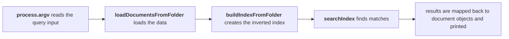

<h1>Mini Search Engine</h1>

Created a small-scale search engine that currently features a TF-IDF ranking layer along with tokenization, document loading, and query searching.
 
 

<h3>TF-IDF Ranking Layer</h3>

The TF-IDF gives better relevancy to the search results by ranking the searched documents based on importance of the words contained. In `indexer.ts`, [buildIndexTfIdf](./indexer.ts#L60) builds a map `term -> set of document id’s` that tracks `termFrequencies` - how many times each term appears in each document - and `documentFrequency` - how many documents contain each term. Essentially, the ranking creates a token count map for each document and a corpus-wide frequency count for each term.

[computeIdf](./indexer.ts#L88) calculates the IDF using the standard formula for inverse document frequency

[rankDocumentsTfIdf](./indexer.ts#L125) loops through query terms, looks up matching docs in index, and adds a score for each document

The [score accumulation](./indexer.ts#L149) is essentially the `current running score + TF * IDF, where TF = 1 + log(frequency(term, doc))`, where 'current running score' = the score a document has accumulated so far point while the loop is processing query terms
 
 

<h3>Tokenizer, Document Loading, Query Search</h3>

The [tokenizer](./tokenizer.ts) normalizes the raw text into a list of searchable terms with lowercase conversion, punctuation/symbol removal, and text splitting on whitespace (“Hash Table” becomes `[“hash”, “table"]`). Document loading ([loadDocumentsFromFolder](./indexer.ts#L162) also found in `indexer.ts`) reads through the JSON `text-files` and parses each into document objects. The query search reads the query input (`-- <query>`) from the search command and utilizes the other three features to create a result that is sorted and ordered by how many query terms matched.
 
 

<h3>CLI</h3>

[cli.ts](./cli.ts) is basically the command line entry point for the search engine, and it executes the four features mentioned above when the search command is run - `npm run search -- <query>`

A [--debug](./cli.ts#L5) flag was added to the CLI to check that the ranking values work as intended, and is used like `npm run search -- --debug "hash map”`. This returns the ranking values of each document containing the term
 
 

<h3>Time/Space Complexity</h3>

Currently, the big O complexity of the search engine is mostly linear, with `indexer.ts` looping over each document and its unique terms before creating the query response to build the index, and [searchIndex](./indexer.ts#L99) tokenizing each term, looking each up in the map, and iterating through the posting list for matching terms. As the size of the project grows, the goal is to lower the complexity down closer to constant by reducing some of the repeated work during indexing and query processing.
 
 

<h2>Demo</h2>

 

